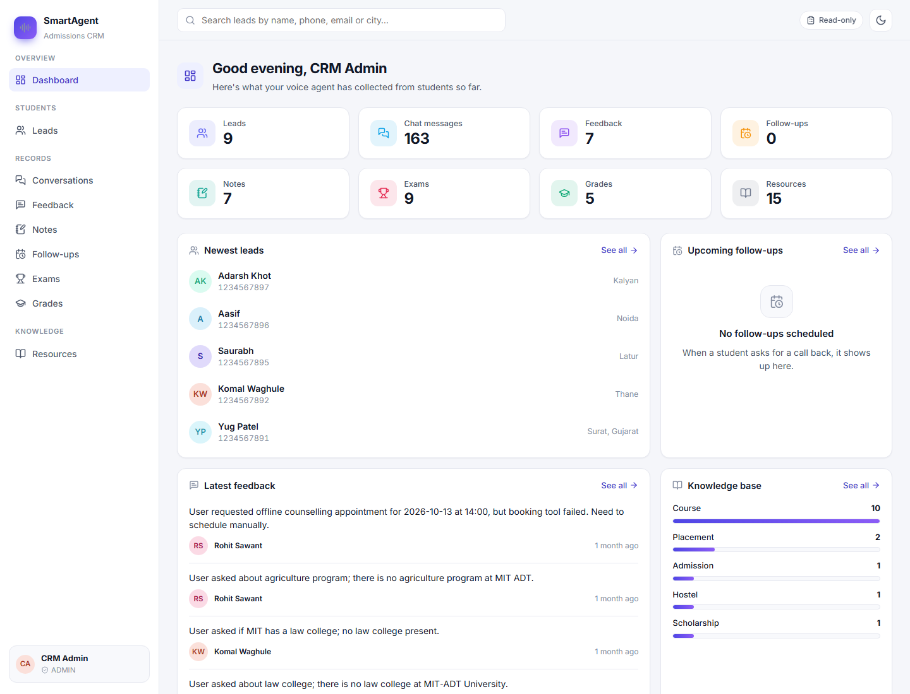
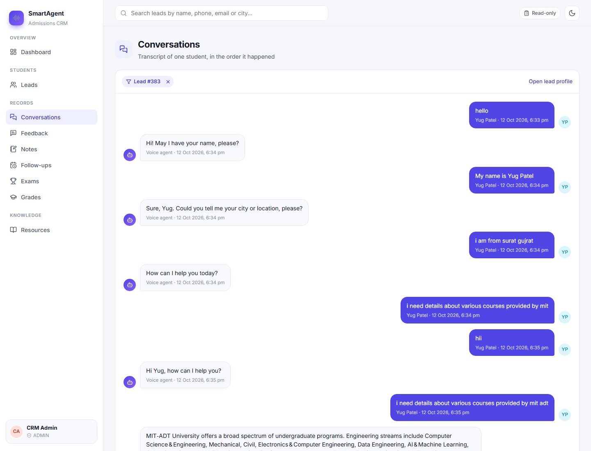
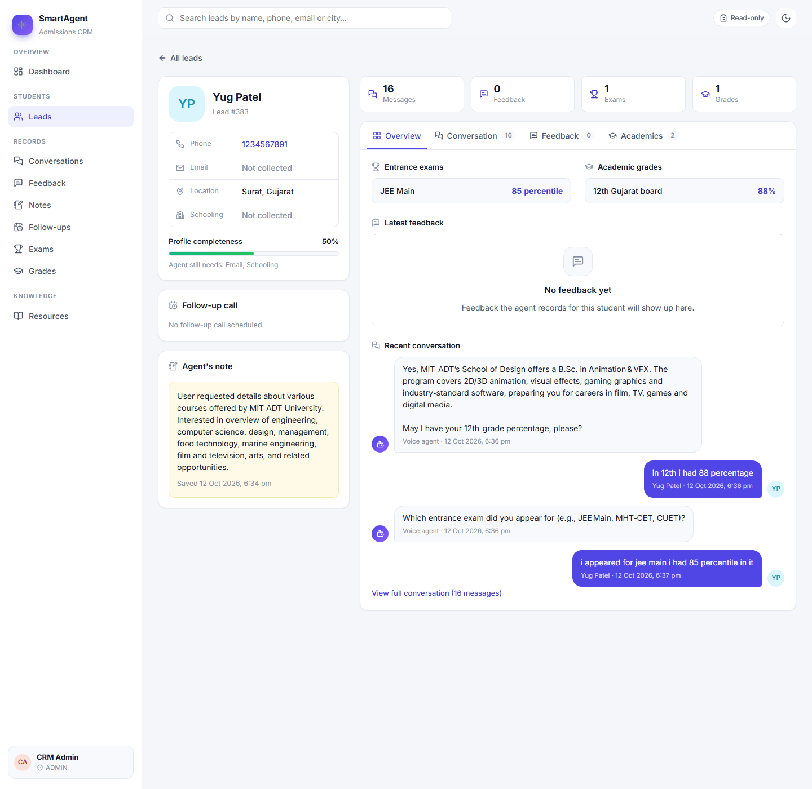
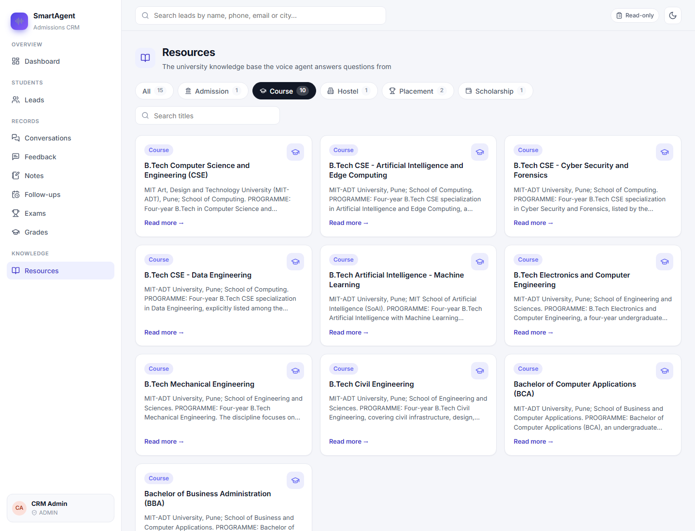
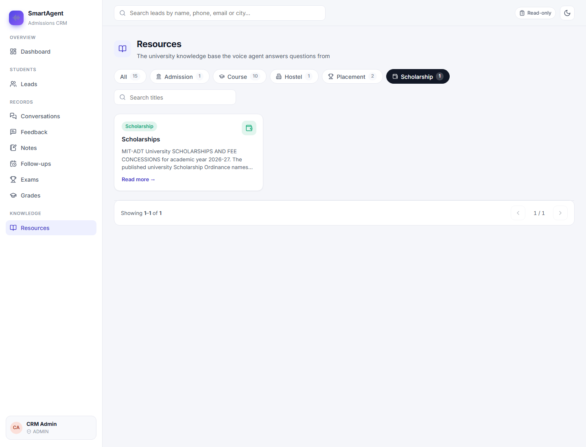
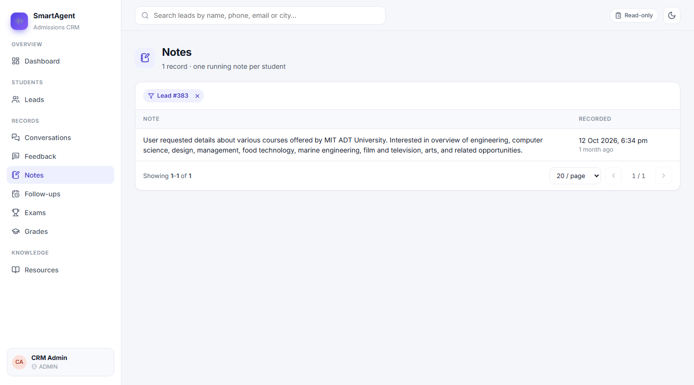
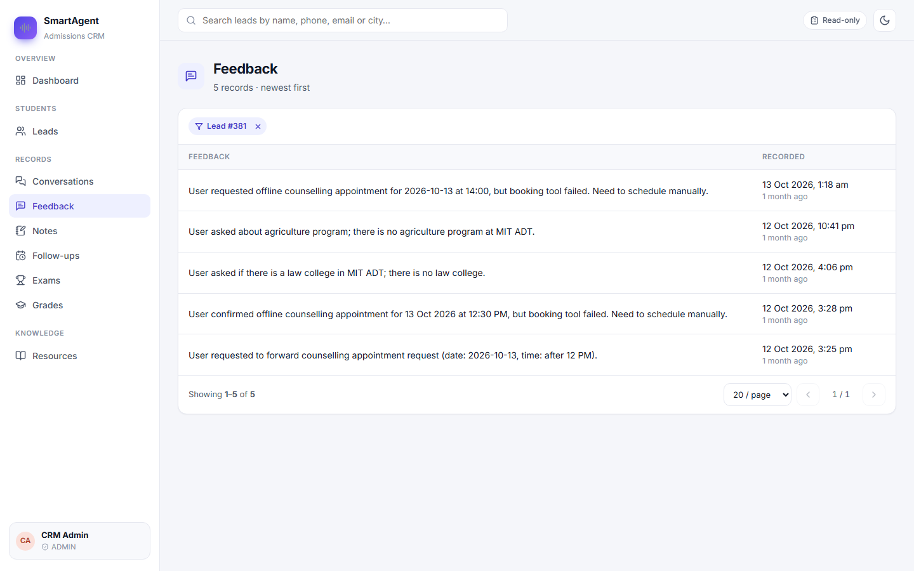
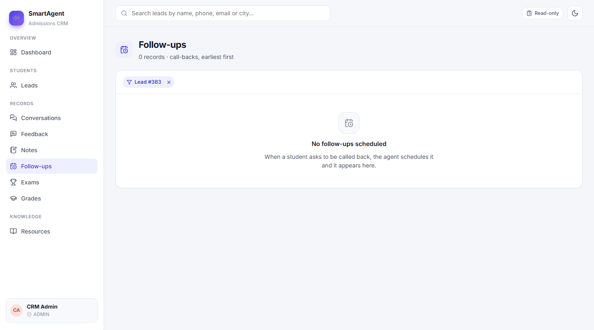

# SmartAgent: Application Screenshots

Captured from the running app (frontend `http://localhost:5173`, CRM API `http://localhost:8081/crm`) at 1440px width, in light mode. Student-specific screens use **Yug Patel (Lead #383)**, except feedback, which uses **Rohit Sawant (Lead #381)**.

| Figure | Screenshot | Page | Image |
|---|---|---|---|
| 1 | Main dashboard | `/` | [fig1-dashboard.png](images/fig1-dashboard.png) |
| 2 | AI chatbot conversation | `/chats?leadId=383` | [fig2-ai-chatbot-conversation.png](images/fig2-ai-chatbot-conversation.png) |
| 3 | Student profile and academic details | `/leads/383` | [fig3-student-profile-academics.png](images/fig3-student-profile-academics.png) |
| 4a | Programme recommendations (course knowledge base) | `/resources?category=COURSE` | [fig4a-programme-recommendations.png](images/fig4a-programme-recommendations.png) |
| 4b | Scholarship recommendations | `/resources?category=SCHOLARSHIP` | [fig4b-scholarship-recommendations.png](images/fig4b-scholarship-recommendations.png) |
| 5 | Lead management (Hot/Warm/Cold) | — | **Skipped:** not present in the application |
| 6 | Conversation summary and notes | `/notes?leadId=383` | [fig6-conversation-notes.png](images/fig6-conversation-notes.png) |
| 6b | Student feedback (Rohit Sawant, Lead #381) | `/feedbacks?leadId=381` | [fig6b-student-feedback.png](images/fig6b-student-feedback.png) |
| 7 | Follow-up and appointment booking | `/schedules?leadId=383` | [fig7-follow-up-appointments.png](images/fig7-follow-up-appointments.png) |
| 8 | Voice call interaction / Twilio interface | — | **Skipped:** no Twilio/voice-call screen in the frontend |

## Figure 1: Main dashboard

## Figure 2: AI chatbot conversation

## Figure 3: Student profile and academic details

## Figure 4: Programme and scholarship recommendations

## Figure 6: Conversation summary and notes

## Figure 7: Follow-up and appointment booking

> Yug Patel had no follow-ups scheduled at capture time, so this page shows its empty state.
